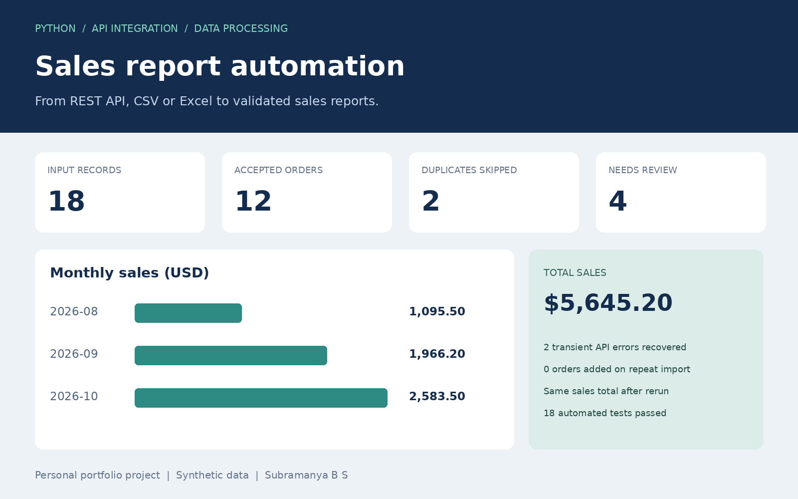

# Sales Report Automation

**Import sales from a REST API, CSV or Excel. Validate each order, skip duplicates across runs, and export a sales workbook with a review trail.**

A personal portfolio demonstration by Subramanya B S. All included business records are synthetic. This is a runnable Python tool, with a local demo API and generated report examples. It is not connected to any employer or client system.



## The business problem

An operations team receives order data from another system or a spreadsheet. Manually merging files can duplicate orders, mix currencies or hide invalid records. This tool keeps accepted orders in SQLite and separates uncertain records for human review.

## What it does

- Reads a paginated REST API or a UTF-8 CSV / `.xlsx` worksheet.
- Supports bearer tokens from an environment variable.
- Retries HTTP 429, 500, 502, 503 and 504 plus network timeouts, with bounded backoff and `Retry-After` handling.
- Rejects ambiguous dates, invalid quantities/prices and currencies different from the selected reporting currency.
- Skips identical order IDs and flags conflicting IDs without overwriting stored records.
- Commits each import transactionally to SQLite.
- Generates a formatted Excel workbook, a local HTML summary, and machine-readable JSON.
- Logs operational counts and failures without logging tokens or order payloads.

## Quick start

Use Python 3.11 or later. From the extracted project directory:

```bash
python -m venv .venv
```

Activate it on **Windows PowerShell**:

```powershell
.\.venv\Scripts\Activate.ps1
```

Or on **Linux/macOS**:

```bash
source .venv/bin/activate
```

Install and run:

```bash
python -m pip install -e .
python -m sales_report.demo
```

The demo starts an ephemeral API on your computer, imports its three pages, then repeats the import. The API deliberately returns one HTTP 429 and one HTTP 503 before succeeding. It shuts down after the two runs. No external account, API key or paid service is required.

Open the printed `report_directory` and double-click `report.html`, or open `sales-report.xlsx` in Excel/LibreOffice.

### Verified demo results

| Metric | First run | Repeat run |
|---|---:|---:|
| Input records | 18 | 18 |
| New orders | 12 | 0 |
| Exact duplicates skipped | 2 | 14 |
| Rejected records | 4 | 4 |
| API retries | 2 | 0 |
| Stored orders | 12 | 12 |
| Sales (USD) | 5,645.20 | 5,645.20 |

The four rejected records contain an ambiguous date, a negative quantity, an unexpected currency and a conflicting order ID. The repeat run counts every incoming record that matches an existing order as a duplicate, including the two repeated rows in the source file.

## Use your own files

```bash
python -m sales_report import --file examples/orders.csv --currency USD
python -m sales_report import --file your-orders.xlsx --sheet Orders --currency USD
```

Input headers must be unique and include:

```text
order_id,order_date,customer,product,quantity,unit_price,currency
```

| Field | Rule |
|---|---|
| `order_id` | Nonempty unique identifier for one complete order |
| `order_date` | `YYYY-MM-DD`, or a native Excel date at midnight |
| `customer`, `product` | Nonempty text, maximum 200 characters |
| `quantity` | Positive integer, maximum 999999 |
| `unit_price` | Nonnegative decimal with at most two decimal places, no currency symbols |
| `currency` | Must match `--currency`; no foreign exchange conversion |

Every row represents **one complete order**, not a separate order line. For multi-line orders, adapt the identity to `(order_id, line_id)` before using the tool. Leading/trailing spaces are removed. Blank Excel rows are skipped. Extra source columns are ignored. The first Excel sheet is read unless `--sheet` is supplied. Formulas are not evaluated or executed; required fields containing formulas are rejected or preserved as literal text as appropriate. Export headers are for human readers and intentionally differ from the input schema.

## Connect a REST API

```bash
python -m sales_report import --api https://your-api.example/orders --token-env SALES_API_TOKEN
```

Set `SALES_API_TOKEN` locally using your operating system's environment-variable tools. Do not put the token in the URL, source code or version control. The `--token-env` flag names the environment variable; it does not contain the token.

Expected response for `GET /orders?page=1`:

```json
{
  "items": [
    {
      "order_id": "A-101",
      "order_date": "2026-10-01",
      "customer": "Demo Store",
      "product": "Router",
      "quantity": 2,
      "unit_price": "149.50",
      "currency": "USD"
    }
  ],
  "next_page": 2
}
```

The last page uses `"next_page": null`. Prices are ideally JSON strings to preserve decimal precision. The endpoint adapter is deliberately explicit: APIs with cursors, OAuth refresh, different field names or nested order lines need an adapter change. Remote APIs require HTTPS. Redirects are rejected to avoid forwarding bearer tokens. Only localhost accepts HTTP for the demo.

## Outputs and recovery

Default paths:

```text
output/
  orders.sqlite3
  pipeline.log
  reports/<run-id>/
    sales-report.xlsx
    report.html
    summary.json
    review.json
```

Workbook sheets:

1. **Summary:** import counts, cumulative sales and monthly totals.
2. **Clean orders:** all stored accepted orders at export time, with typed dates, quantities and prices.
3. **Import review:** skipped duplicates and rejected records from the selected import, with reasons and original payloads.

Amounts use Python `Decimal` for calculation, then numeric Excel cells for display. Each order and the total are capped at USD 999,999,999,999.99 (or equivalent reporting units) to stay within supported Excel precision. Workbook totals are generated values, not live Excel formulas. Edit the source and rerun the pipeline to update them.

Import counts describe one run. Sales totals describe all accepted orders stored at export time. Exporting an old run again uses the **current** accepted-order database, so its sales totals can differ from an original export. Original report folders are never overwritten.

API pagination must finish successfully before anything is imported. Imports use one database transaction. Reports are written to a temporary directory and published together. If export fails after a database commit, the error gives the committed run ID. Regenerate without reimporting:

```bash
python -m sales_report --output output/recovered report --run-id YOUR_RUN_ID
```

Exit code `0` means the pipeline completed, even if rows need review; inspect `summary.json` for rejected counts. Exit code `1` indicates an import or report failure. Invalid command syntax uses argparse's exit code `2`.

## Scheduling

The tool runs once per invocation. Schedule it using cron or Windows Task Scheduler. Supply absolute paths and use a persistent database.

Example daily cron at **08:00 in the host's configured timezone** (replace all paths):

```cron
0 8 * * * /absolute/project/.venv/bin/python -m sales_report --db /absolute/data/orders.sqlite3 --output /absolute/reports --log /absolute/logs/sales.log import --file /absolute/data/orders.csv --currency USD
```

Windows Task Scheduler: choose the virtual environment's `python.exe` as the program, use the same arguments, and set **Start in** to the project directory. Configure “Do not start a new instance” if the task is already running. SQLite serializes writes; a second writer can fail after a one-second lock timeout. Avoid overlapping scheduled runs.

The included GitHub Actions workflow runs tests and the synthetic demo on push, pull request or manual trigger. It does **not** operate a real scheduled client import or preserve a production SQLite database across CI runners.

## Tests

```bash
python -m unittest discover -s tests -v
```

Tests cover validation boundaries, decimal totals, native Excel dates, duplicate and conflict decisions, transaction rollback, output reconciliation, literal Excel text, pagination, transient HTTP failures, retry limits, endpoint restrictions and missing tokens. Local HTTP tests do not depend on the public internet.

## Boundaries

- One reporting currency per database. Taxes, discounts, shipping, refunds, returns and cancelled orders are outside this version's schema.
- No built-in UI for correcting rejected records. Fix the source and rerun; existing accepted orders are not automatically updated.
- API limits: 1000 pages, 100000 records, 10 MiB response per page; input files capped at 25 MiB. This is an in-memory import suitable for modest datasets, not streaming at warehouse scale.
- Customer names and original rejected payloads are intentionally included in local reports/database. Protect output files and do not publish real customer exports in a portfolio. Included examples are synthetic.
- No production performance or hours-saved claims have been measured. The demo proves behavior, not commercial deployment.

See [portfolio copy](docs/PORTFOLIO.md), [requirements mapping](docs/REQUIREMENTS.md), and [demo walkthrough](docs/DEMO.md).
